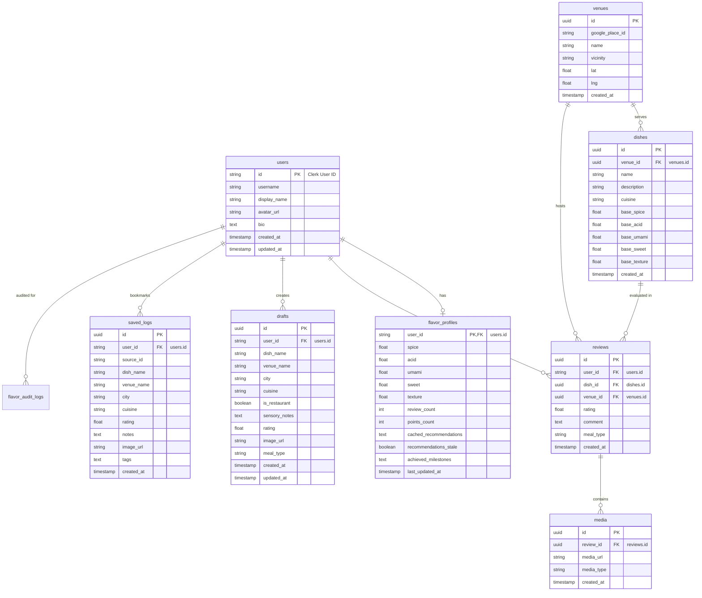

# JustAteIt — API & Data Layer Specification 📖

This document serves as the comprehensive **API, Data Model, and Architectural Specification** for the **JustAteIt** platform, prepared for **Sponsor Handoff (Task #1215)**.

---

## Table of Contents
1. [System Architecture Diagram](#1-system-architecture-diagram)
   - [Mermaid Architecture](#mermaid-architecture)
   - [ASCII Network Topology](#ascii-network-topology)
2. [Data Layer & Database Schemas](#2-data-layer--database-schemas)
   - [Database Entity Relationship Diagram](#database-entity-relationship-diagram)
   - [Table: `users`](#table-users)
   - [Table: `flavor_profiles`](#table-flavor_profiles)
   - [Table: `venues`](#table-venues)
   - [Table: `dishes`](#table-dishes)
   - [Table: `reviews`](#table-reviews)
   - [Table: `drafts`](#table-drafts)
   - [Table: `saved_logs`](#table-saved_logs)
   - [Table: `media`](#table-media)
   - [Table: `flavor_audit_logs`](#table-flavor_audit_logs)
3. [Core Services & Endpoint Reference](#3-core-services--endpoint-reference)
   - [Location Autocomplete Service (`/api/v1/places/*`)](#location-autocomplete-service)
   - [Meal Logging & Review Service (`/api/v1/reviews/*`)](#meal-logging--review-service)
   - [Drafts Management Service (`/api/v1/drafts/*`)](#drafts-management-service)
   - [Saved Logs & Bookmarks Service (`/api/v1/saved-logs/*`)](#saved-logs--bookmarks-service)
   - [User & Flavor Profile Service (`/api/v1/flavor-profiles/*` & `/api/v1/users/*`)](#user--flavor-profile-service)
   - [Media & Photo Upload Service (`/api/v1/media/*`)](#media--photo-upload-service)
4. [Flavor Recommendation & Tagging System (v1)](#4-flavor-recommendation--tagging-system-v1)
   - [Adaptive Learning Formula](#adaptive-learning-formula)
   - [Curated Flavor Tagging System](#curated-flavor-tagging-system)

---

## 1. System Architecture Diagram

### Mermaid Architecture

```mermaid
flowchart TD
    subgraph ClientLayer ["Client Layer (Expo / React Native)"]
        ClientApp["React Native App\n(iOS, Android, Web)"]
        ExpoRouter["Expo Router v57"]
        ClerkSDK["@clerk/clerk-expo\n(Session & Identity)"]
    end

    subgraph AuthProvider ["Authentication"]
        ClerkAuth["Clerk Auth Cloud\n(JWT Tokens & User IDs)"]
    end

    subgraph IngressLayer ["Ingress & Routing"]
        APIGateway["FastAPI API Gateway (:8000)\n60s Timeouts, CORS, Proxying"]
    end

    subgraph Microservices ["FastAPI Microservice Fleet"]
        UserService["user_service (:8001)\nProfiles, Flavor DNA, Recs"]
        CatalogService["catalog_service (:8002)\nReviews, Drafts, Venues, Dishes"]
        MediaService["media_service (:8003)\nUpload Handler & S3 Client"]
    end

    subgraph DataStorage ["Persistence & External Services"]
        SupabaseDB[("Supabase PostgreSQL\nAWS us-east-2")]
        NominatimAPI["OpenStreetMap Nominatim\n(Zero-Cost Venue Autocomplete)"]
        GooglePlacesAPI["Google Places API\n(GPS Nearby Fallback)"]
        AnthropicClaude["Anthropic Claude API\n(Flavor Recommendations)"]
        AWSS3[("AWS S3 Media Bucket\n[Pending Sponsor IAM Credentials]")]
    end

    ClientApp --> ClerkSDK
    ClerkSDK <--> ClerkAuth
    ClientApp -->|HTTP /api/v1/*| APIGateway

    APIGateway -->|/api/v1/users/*\n/api/v1/flavor-profiles/*| UserService
    APIGateway -->|/api/v1/reviews/*\n/api/v1/places/*\n/api/v1/drafts/*\n/api/v1/saved-logs/*| CatalogService
    APIGateway -->|/api/v1/media/*| MediaService

    UserService -->|SQLAlchemy / Pooler| SupabaseDB
    UserService -->|Prompts| AnthropicClaude

    CatalogService -->|SQLAlchemy / Pooler| SupabaseDB
    CatalogService -->|Debounced GET| NominatimAPI
    CatalogService -->|Fallback| GooglePlacesAPI

    MediaService -.->|Boto3 PutObject\n[Pending Sponsor IAM]| AWSS3
```

### ASCII Network Topology

```
+---------------------------------------------------------------------------------------+
|                                CLIENT APPLICATION                                     |
|                       React Native / Expo SDK 57 (Web & Mobile)                       |
+-------------------------------------------+-------------------------------------------+
                                            |
                         Bearer Token / User Identification
                                            v
+---------------------------------------------------------------------------------------+
|                                  API GATEWAY (:8000)                                  |
|               Central reverse-proxy mapping /api/v1/* routes with 60s timeout         |
+-------------------+-----------------------+-----------------------+-------------------+
                    |                       |                       |
                    v                       v                       v
          +-------------------+   +-------------------+   +-------------------+
          |   user_service    |   |  catalog_service  |   |   media_service   |
          |      (:8001)      |   |      (:8002)      |   |      (:8003)      |
          +---------+---------+   +---------+---------+   +---------+---------+
                    |                       |                       |
                    | (Session Pooler:5432) |                       |
                    +-----------+-----------+                       | (Boto3 S3 API)
                                |                                   |
                                v                                   v
                    +-----------------------+           +-----------------------+
                    | Supabase (PostgreSQL) |           |      AWS S3 Bucket    |
                    | Direct & Migrations   |           |  [Pending Sponsor IAM |
                    +-----------------------+           |      Credentials]     |
                                |                       +-----------------------+
                                v
               +----------------------------------+
               | External Upstream APIs           |
               | - OpenStreetMap Nominatim (Free) |
               | - Google Places API (GPS Vicinity|
               | - Anthropic Claude 3.5 Sonnet    |
               +----------------------------------+
```

---

## 2. Data Layer & Database Schemas

### Database Entity Relationship Diagram



---

### Table: `users`
Stores user profile information keyed to the Clerk Authentication User ID.

| Column | Type | Constraints | Description |
| --- | --- | --- | --- |
| `id` | `VARCHAR` | `PRIMARY KEY` | Clerk authenticated user ID (e.g. `user_2t...`). |
| `username` | `VARCHAR` | `NULLABLE` | Unique user handle. |
| `display_name` | `VARCHAR` | `NULLABLE` | User's full or preferred name. |
| `avatar_url` | `VARCHAR` | `NULLABLE` | Link to profile photo. |
| `bio` | `TEXT` | `NULLABLE` | Short biographical statement. |
| `created_at` | `TIMESTAMP` | `DEFAULT NOW()` | Record creation timestamp. |
| `updated_at` | `TIMESTAMP` | `DEFAULT NOW()` | Last update timestamp. |

---

### Table: `flavor_profiles`
Maintains the mathematical Bayesian taste weights across the five core flavor dimensions.

| Column | Type | Constraints | Description |
| --- | --- | --- | --- |
| `user_id` | `VARCHAR` | `PRIMARY KEY, FK users(id) ON DELETE CASCADE` | Associated user. |
| `spice` | `FLOAT` | `DEFAULT 0.35` | Normalized heat affinity ($[0.0, 1.0]$). |
| `acid` | `FLOAT` | `DEFAULT 0.50` | Normalized acid/tart affinity ($[0.0, 1.0]$). |
| `umami` | `FLOAT` | `DEFAULT 0.70` | Normalized savory depth affinity ($[0.0, 1.0]$). |
| `sweet` | `FLOAT` | `DEFAULT 0.30` | Normalized sweetness affinity ($[0.0, 1.0]$). |
| `texture` | `FLOAT` | `DEFAULT 0.45` | Normalized texture/crunch affinity ($[0.0, 1.0]$). |
| `review_count` | `INTEGER` | `DEFAULT 0` | Total number of rated experiences. |
| `points_count` | `INTEGER` | `DEFAULT 0` | Gamification points for level progression. |
| `cached_recommendations` | `TEXT` | `NULLABLE` | JSON-encoded Claude recommendation payload. |
| `recommendations_stale` | `BOOLEAN` | `DEFAULT TRUE` | Dirty flag triggering AI recalculation. |
| `achieved_milestones` | `TEXT` | `NULLABLE` | JSON-encoded list of unlocked badge strings. |
| `last_updated_at` | `TIMESTAMP` | `DEFAULT NOW()` | Timestamp of last profile recalculation. |

---

### Table: `venues`
Dining locations identified either through OpenStreetMap Nominatim or Google Places.

| Column | Type | Constraints | Description |
| --- | --- | --- | --- |
| `id` | `UUID` | `PRIMARY KEY, DEFAULT gen_random_uuid()` | Unique venue identifier. |
| `google_place_id` | `VARCHAR` | `UNIQUE, NULLABLE` | Google Places reference key (if resolved). |
| `name` | `VARCHAR` | `NOT NULL` | Restaurant or establishment name. |
| `vicinity` | `VARCHAR` | `NULLABLE` | City, street, or locality description. |
| `lat` | `FLOAT` | `NULLABLE` | GPS Latitude. |
| `lng` | `FLOAT` | `NULLABLE` | GPS Longitude. |
| `created_at` | `TIMESTAMP` | `DEFAULT NOW()` | Record creation timestamp. |

---

### Table: `dishes`
Individual dishes reviewed across venues.

| Column | Type | Constraints | Description |
| --- | --- | --- | --- |
| `id` | `UUID` | `PRIMARY KEY, DEFAULT gen_random_uuid()` | Unique dish identifier. |
| `venue_id` | `UUID` | `FK venues(id) ON DELETE CASCADE, NULLABLE` | Serving venue (null for home-cooked). |
| `name` | `VARCHAR` | `NOT NULL` | Name of the dish (e.g. *"Spicy Dan Dan Mian"*). |
| `description` | `VARCHAR` | `NULLABLE` | Menu or user description. |
| `cuisine` | `VARCHAR` | `NULLABLE` | Cuisine category (e.g. *"Sichuan"*, *"Italian"*). |
| `base_spice` | `FLOAT` | `DEFAULT 0.50` | Inherent dish heat attribute ($[0.0, 1.0]$). |
| `base_acid` | `FLOAT` | `DEFAULT 0.50` | Inherent dish acid attribute ($[0.0, 1.0]$). |
| `base_umami` | `FLOAT` | `DEFAULT 0.50` | Inherent dish savory attribute ($[0.0, 1.0]$). |
| `base_sweet` | `FLOAT` | `DEFAULT 0.50` | Inherent dish sweet attribute ($[0.0, 1.0]$). |
| `base_texture` | `FLOAT` | `DEFAULT 0.50` | Inherent dish texture attribute ($[0.0, 1.0]$). |
| `created_at` | `TIMESTAMP` | `DEFAULT NOW()` | Record creation timestamp. |

---

### Table: `reviews`
Published food logs / journal entries.

| Column | Type | Constraints | Description |
| --- | --- | --- | --- |
| `id` | `UUID` | `PRIMARY KEY, DEFAULT gen_random_uuid()` | Unique review ID. |
| `user_id` | `VARCHAR` | `NOT NULL` | Author's Clerk User ID. |
| `dish_id` | `UUID` | `FK dishes(id) ON DELETE CASCADE, NOT NULL` | Target dish reviewed. |
| `venue_id` | `UUID` | `FK venues(id) ON DELETE SET NULL, NULLABLE` | Dining venue. |
| `rating` | `FLOAT` | `NOT NULL` | Score from $1.0$ to $5.0$. |
| `comment` | `TEXT` | `NULLABLE` | User sensory notes & embedded flavor tags. |
| `meal_type` | `VARCHAR` | `NULLABLE` | Classification: `Breakfast`, `Lunch`, `Dinner`, `Snack`. |
| `created_at` | `TIMESTAMP` | `DEFAULT NOW()` | Date of archive. |

---

### Table: `drafts`
Unpublished experiences stored before final review archive.

| Column | Type | Constraints | Description |
| --- | --- | --- | --- |
| `id` | `UUID` | `PRIMARY KEY, DEFAULT gen_random_uuid()` | Unique draft ID. |
| `user_id` | `VARCHAR` | `NOT NULL` | Clerk user author. |
| `dish_name` | `VARCHAR` | `NULLABLE` | Temporary dish name. |
| `venue_name` | `VARCHAR` | `NULLABLE` | Temporary venue name. |
| `city` | `VARCHAR` | `NULLABLE` | City or locality. |
| `cuisine` | `VARCHAR` | `NULLABLE` | Cuisine tag. |
| `is_restaurant` | `BOOLEAN` | `DEFAULT TRUE` | Restaurant vs. home-cooked toggle. |
| `sensory_notes` | `TEXT` | `NULLABLE` | In-progress notes & flavor tags. |
| `rating` | `FLOAT` | `NULLABLE` | Optional rating. |
| `image_url` | `VARCHAR` | `NULLABLE` | Uploaded image link. |
| `meal_type` | `VARCHAR` | `NULLABLE` | Inferred or selected meal type. |
| `created_at` | `TIMESTAMP` | `DEFAULT NOW()` | Draft initiation timestamp. |
| `updated_at` | `TIMESTAMP` | `DEFAULT NOW()` | Last update timestamp. |

---

### Table: `saved_logs`
User bookmarks for dishes to try later.

| Column | Type | Constraints | Description |
| --- | --- | --- | --- |
| `id` | `UUID` | `PRIMARY KEY, DEFAULT gen_random_uuid()` | Unique bookmark ID. |
| `user_id` | `VARCHAR` | `NOT NULL` | Clerk user ID who bookmarked. |
| `source_id` | `VARCHAR` | `NOT NULL` | Original dish or recommendation card ID. |
| `dish_name` | `VARCHAR` | `NOT NULL` | Dish title. |
| `venue_name` | `VARCHAR` | `NULLABLE` | Restaurant name. |
| `city` | `VARCHAR` | `NULLABLE` | City location. |
| `cuisine` | `VARCHAR` | `NULLABLE` | Cuisine type. |
| `rating` | `FLOAT` | `NULLABLE` | Star rating at time of bookmark. |
| `notes` | `TEXT` | `NULLABLE` | Flavor notes or commentary. |
| `image_url` | `VARCHAR` | `NULLABLE` | Card photo URL. |
| `tags` | `TEXT` | `NULLABLE` | JSON-encoded string array of card tags. |
| `created_at` | `TIMESTAMP` | `DEFAULT NOW()` | Bookmark date. |

---

### Table: `media`
Images linked to reviews.

| Column | Type | Constraints | Description |
| --- | --- | --- | --- |
| `id` | `UUID` | `PRIMARY KEY, DEFAULT gen_random_uuid()` | Unique media record ID. |
| `review_id` | `UUID` | `FK reviews(id) ON DELETE CASCADE, NOT NULL` | Target review. |
| `media_url` | `VARCHAR` | `NOT NULL` | S3 public or CloudFront URL. |
| `media_type` | `VARCHAR` | `DEFAULT 'image'` | Type identifier. |
| `created_at` | `TIMESTAMP` | `DEFAULT NOW()` | Upload timestamp. |

---

### Table: `flavor_audit_logs`
Historical log of Bayesian taste evolution.

| Column | Type | Constraints | Description |
| --- | --- | --- | --- |
| `id` | `UUID` | `PRIMARY KEY, DEFAULT gen_random_uuid()` | Audit event ID. |
| `user_id` | `VARCHAR` | `NOT NULL` | Target user. |
| `dish_id` | `UUID` | `FK dishes(id), NULLABLE` | Stimulus dish. |
| `rating` | `FLOAT` | `NOT NULL` | User score ($1-5$). |
| `alpha` | `FLOAT` | `NOT NULL` | Learning rate used for update. |
| `old_profile` | `JSONB` | `NOT NULL` | Taste vector before review. |
| `new_profile` | `JSONB` | `NOT NULL` | Taste vector after review. |
| `created_at` | `TIMESTAMP` | `DEFAULT NOW()` | Calculation timestamp. |

---

## 3. Core Services & Endpoint Reference

### Location Autocomplete Service

#### `GET /api/v1/places/autocomplete`
Provides zero-cost, privacy-friendly text-search autocomplete powered by OpenStreetMap Nominatim for dining establishments.

- **Rate Limits & Fair Use**: Upstream allows max 1 req/sec. Client callers **must debounce by $\ge$ 350 ms**.
- **Minimum Characters**: Queries with $< 3$ trimmed characters immediately return `{"suggestions": []}`.

**Query Parameters**:
| Parameter | Type | Required | Default | Description |
| --- | --- | --- | --- | --- |
| `q` | `string` | **Yes** | — | Search query string (e.g. `"Tartine"`). |
| `limit` | `integer` | No | `6` | Maximum venue matches to return. |

**cURL Example**:
```bash
curl -X GET "http://localhost:8000/api/v1/places/autocomplete?q=Tartine&limit=4" \
     -H "Accept: application/json"
```

**TypeScript Response Payload**:
```typescript
interface VenueSuggestion {
  name: string;      // e.g. "Tartine Bakery"
  address: string;   // e.g. "Guerrero Street, San Francisco"
  fullName: string;  // Full canonical OpenStreetMap display string
}

interface AutocompleteResponse {
  suggestions: VenueSuggestion[];
}
```

---

### Meal Logging & Review Service

#### `POST /api/v1/reviews`
Creates a new verified food review, lazily registering the venue and dish if they do not yet exist, and triggering an asynchronous background recalculation of the user's taste profile and gamification points.

**cURL Example**:
```bash
curl -X POST "http://localhost:8000/api/v1/reviews" \
     -H "Content-Type: application/json" \
     -d '{
       "user_id": "user_2testClerkId123",
       "dish_name": "Smoked Brisket",
       "venue_name": "Franklin Barbecue",
       "city": "Austin, TX",
       "cuisine": "American",
       "is_restaurant": true,
       "rating": 5.0,
       "sensory_notes": "[Flavors: Smoky, Rich, Salty]\nTender bark with deep post-oak smoke ring.",
       "image_url": "https://justateit-prod-media-bucket.s3.amazonaws.com/uploads/brisket.webp",
       "meal_type": "Lunch",
       "flavor_tags": ["Smoky", "Rich", "Salty"]
     }'
```

**TypeScript Request Payload**:
```typescript
interface ReviewPayload {
  user_id: string;
  dish_name: string;
  venue_name?: string | null;
  city?: string | null;
  cuisine?: string | null;
  is_restaurant?: boolean;
  rating: number; // 1.0 - 5.0
  sensory_notes?: string | null;
  image_url?: string | null;
  meal_type?: 'Breakfast' | 'Lunch' | 'Dinner' | 'Snack' | null;
  flavor_tags?: string[] | null;
}
```

**TypeScript Response Payload (`HTTP 200 OK`)**:
```typescript
interface CreateReviewResponse {
  message: string;        // "Review created successfully"
  review_id: string;      // UUID
  points_earned: number;  // 5
}
```

#### `GET /api/v1/reviews/{user_id}`
Retrieves all historical food logs for a user, sorted newest first.

**cURL Example**:
```bash
curl -X GET "http://localhost:8000/api/v1/reviews/user_2testClerkId123"
```

**TypeScript Response Payload**:
```typescript
interface UserReviewItem {
  id: string;
  dish_name: string;
  venue_name: string | null;
  rating: number;
  sensory_notes: string | null;
  image_url: string | null;
  meal_type: 'Breakfast' | 'Lunch' | 'Dinner' | 'Snack' | null;
  created_at: string; // ISO 8601
}

interface UserReviewsResponse {
  reviews: UserReviewItem[];
  count: number;
}
```

---

### Drafts Management Service

#### `POST /api/v1/drafts`
Saves an in-progress meal log for future editing.

**TypeScript Request Payload**:
```typescript
interface DraftPayload {
  user_id: string;
  dish_name?: string | null;
  venue_name?: string | null;
  city?: string | null;
  cuisine?: string | null;
  is_restaurant?: boolean;
  rating?: number | null;
  sensory_notes?: string | null;
  image_url?: string | null;
  meal_type?: 'Breakfast' | 'Lunch' | 'Dinner' | 'Snack' | null;
  flavor_tags?: string[] | null;
}
```

#### `POST /api/v1/drafts/{draft_id}/publish`
Promotes an existing draft into a permanent `Review`, executing flavor profile recalculation and deleting the draft.

---

### Saved Logs & Bookmarks Service

#### `POST /api/v1/saved-logs`
Bookmarks a dish from recommendations or feed.

**TypeScript Request Payload**:
```typescript
interface SavedLogPayload {
  user_id: string;
  source_id: string;
  dish_name: string;
  venue_name?: string | null;
  city?: string | null;
  cuisine?: string | null;
  rating?: number | null;
  notes?: string | null;
  image_url?: string | null;
  tags?: string[] | null;
}
```

#### `DELETE /api/v1/saved-logs/{saved_log_id}`
Removes a bookmark by its primary key.

---

### User & Flavor Profile Service

#### `GET /api/v1/flavor-profiles/{user_id}`
Returns the user's active mathematical flavor affinity vector, review count, gamification level points, and personality Archetype.

**cURL Example**:
```bash
curl -X GET "http://localhost:8000/api/v1/flavor-profiles/user_2testClerkId123"
```

**TypeScript Response Payload**:
```typescript
interface ProfileResponse {
  user_id: string;
  profile: {
    spice: number;    // e.g. 0.85
    acid: number;     // e.g. 0.40
    umami: number;    // e.g. 0.90
    sweet: number;    // e.g. 0.20
    texture: number;  // e.g. 0.75
  };
  review_count: number;
  personality: string; // "Spice Chaser" | "Acid Lover" | "Umami Seeker" | "Sweet Tooth" | "Texture Obsessive"
  points_count: number;
  achieved_milestones: string[];
}
```

#### `GET /api/v1/flavor-profiles/{user_id}/recommendations`
Generates personalized restaurant and dish recommendations by grounding Anthropic Claude 3.5 prompts with real catalog venue data and the user's mathematical flavor vector.

**Query Parameters**:
- `exclude` (optional comma-separated dish titles).
- `exclude_venues` (optional comma-separated venue names to force rotational variety).

---

### Media & Photo Upload Service

#### `POST /api/v1/media/upload`
Accepts a `multipart/form-data` payload containing an image file (converted to WebP on mobile) and optional GPS coordinates. Uploads the asset directly to Amazon S3 via `boto3`.

> [!WARNING]
> **Pending Sponsor IAM Credentials**: In dev/staging environments without active AWS credentials, this endpoint returns `503 Service Unavailable` with explicit configuration guidance.

**Request**: `multipart/form-data`
- `file`: Binary image asset (`upload.webp`).
- `latitude` (optional): Float string.
- `longitude` (optional): Float string.

**TypeScript Response Payload**:
```typescript
interface MediaUploadResponse {
  url: string;      // "https://justateit-prod-media-bucket.s3.amazonaws.com/uploads/<uuid>.webp"
  media_id: string; // UUID
}
```

---

## 4. Flavor Recommendation & Tagging System (v1)

### Adaptive Learning Formula

When a user submits a review with rating $R \in [1, 5]$ for a dish having inherent flavor attribute $F_{\text{dish}} \in [0, 1]$, each dimension $P$ in the user's profile is updated according to the formula implemented in `backend/services/user_service/core/flavor_math.py`:

$$\text{signal} = \frac{R - 3}{2} \quad \in [-1.0, +1.0]$$

$$\alpha = \max\left(0.02, \frac{0.3}{N_{\text{reviews}} + 1}\right)$$

$$P_{\text{new}} = \operatorname{clamp}\left(P_{\text{old}} + \alpha \left[ |\text{signal}|(0.5 - P_{\text{old}}) + \text{signal}(F_{\text{dish}} - 0.5) \right], 0.0, 1.0\right)$$

- **Regression Term** $|\text{signal}|(0.5 - P_{\text{old}})$: Pulls extreme ratings towards neutral baseline when noisy reviews occur.
- **Learning Term** $\text{signal}(F_{\text{dish}} - 0.5)$: Advances affinity proportionally when high ratings coincide with strong flavor attributes.
- **Adaptive $\alpha$**: Decreases as review count grows, making established profiles stable while allowing new users to rapidly establish their flavor profile.

### Curated Flavor Tagging System

To complement cuisine selection and meal type detection, the client provides a zero-latency, curated tagging utility (`frontend/utils/flavorProfiles.ts`):

- **Supported Tags**: `Spicy`, `Umami`, `Sweet`, `Tangy`, `Rich`, `Fresh`, `Smoky`, `Salty`, `Crispy`, `Herbal`, `Zesty`, `Earthy`.
- **Intelligent Suggestion Pipeline**:
  1. Inspects the user's entered **Cuisine** (e.g. Mexican $\to$ Spicy, Tangy, Smoky, Fresh).
  2. Parses keywords in the **Dish Name** (e.g. *"Truffle Ramen"* $\to$ Umami, Rich, Salty).
  3. Ranks suggested chips first in the UI while keeping the entire palette selectable.
  4. Restricts user selection to **up to 3 flavor chips** to maintain high signal-to-noise ratio.
  5. Formats tags into `sensory_notes` as `[Flavors: Tag1, Tag2]` ensuring full backward-compatibility across all historical and existing database records.

